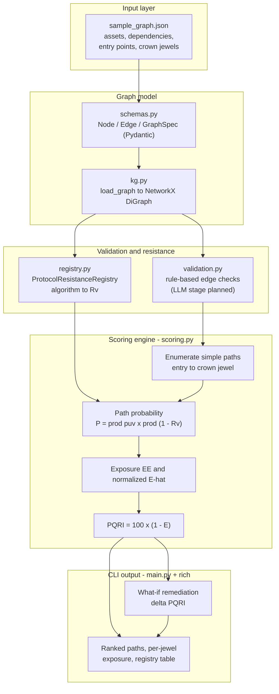

# Claritas Quantum

> Model your infrastructure as a graph, then score how exposed it is to a future quantum attacker — and prove which fix helps most.

**Role: Sole author & engineer · Timeframe: 2026 (research prototype) · Status: Local proof-of-concept (synthetic data) · Live link: none — runs as a local CLI**

---

## The Problem

Quantum computers running Shor's algorithm will eventually break the public-key cryptography (RSA, ECC) that protects most enterprise traffic and data today. NIST has finalized post-quantum standards (FIPS 203–205: ML-KEM, ML-DSA), and organizations are being told to become "quantum ready" — but most cannot even answer *where* weak crypto lives, let alone *which attack paths* let it reach their crown-jewel assets. Without that visibility, migration budgets get spent on the wrong things and "readiness" stays a vibe instead of a number. Attackers compound the urgency with **harvest-now, decrypt-later**: data encrypted with classical crypto can be stolen today and decrypted once quantum hardware arrives.

## What I Built

A local Python proof-of-concept that turns post-quantum readiness into a computable, path-aware score.

- **Dependency graph model** — assets become nodes with a **PQ resistance** value `Rv` (0 = fully vulnerable, 1 = quantum-safe) and a **business weight** `wv`; dependencies become directed edges with an **exploitability** `puv`. Entry points and crown jewels are first-class.
- **Attack-path enumeration** — finds the simple paths from internet-facing entry points to high-value crown jewels, the routes an adversary would actually traverse.
- **Path-based exposure scoring** — each path gets a success probability `P(π) = ∏ puv × ∏ (1 − Rv)`; per-crown-jewel exposure aggregates paths as `1 − ∏(1 − P(π))`, weighted by impact and normalized into a single exposure `E`.
- **PQ Readiness Index (PQRI)** — a single interpretable `PQRI = 100 × (1 − E)` (100 = fully ready, 0 = fully exposed), plus a normalized variant `Ê = EE / E_max` so scores compare across graphs of different size and density.
- **What-if remediation** — harden one node (e.g. raise the web gateway's `Rv` from 0.2 → 0.8), recompute, and report **ΔPQRI** — turning the score into a prioritization tool instead of a static grade.
- **Schema + rule-based validation** — Pydantic schemas keep the graph well-formed, and a rule-based edge validator checks allowed `(src_type, rel, dst_type)` relationships to prune implausible dependencies (the stand-in for a planned LLM-in-the-loop validation stage).

## Architecture



Input is a single JSON graph spec that Pydantic schemas validate and `kg.py` loads into a NetworkX directed graph. A rule-based validator and a protocol-to-resistance registry enrich edges and nodes, then the scoring engine enumerates paths, computes path probabilities, aggregates exposure, and derives PQRI. The orchestrator (`main.py`) renders ranked paths, per-crown-jewel exposure, the resistance registry, and a what-if remediation delta to the terminal with `rich`.

## Tech Stack

- **Web** — none by design; this is a terminal/CLI proof-of-concept. A web dashboard is future work, not part of this repo.
- **Data** — NetworkX (directed dependency graph, simple-path enumeration), Pydantic (typed `Node` / `Edge` / `GraphSpec` schema validation), a JSON sample graph as the single data source.
- **AI** — the research design calls for LLM-in-the-loop validation (Stage 1: edge-relationship plausibility; Stage 2: risk-attribute assignment) with a human review queue. In this PoC that slot is filled by a deterministic **rule-based edge validator**; the LLM stage is pluggable but not yet wired in.
- **Platform** — Python 3, virtual-env workflow, module-style CLI entry point (`python -m src.main`), `rich` for formatted terminal tables and output.
- **Security** — post-quantum cryptography domain modeling: a `ProtocolResistanceRegistry` mapping algorithms to resistance bands (vulnerable / transitional / quantum-safe, framed on NIST FIPS 203–205 — ML-KEM, ML-DSA), weakest-link resistance per asset, and attack-path / crown-jewel risk modeling.

## Highlights / Results

- **Six focused modules, clean separation of concerns** — `schemas.py` (validation), `kg.py` (graph build), `registry.py` (algorithm → resistance), `validation.py` (edge rules), `scoring.py` (paths, exposure, PQRI), `main.py` (orchestration + CLI). Each maps directly to one stage of the pipeline.
- **One composable risk formula** — edge exploitability and node resistance multiply along a path into a single probability, and per-crown-jewel exposure uses `1 − ∏(1 − P(π))` to answer "what's the chance *any* path succeeds." The model is small enough to audit by hand.
- **Normalized exposure for comparability** — computing `E_max` by zeroing every node's resistance and dividing yields `Ê = EE / E_max`, so a PQRI from a 10-node graph means the same thing as one from a larger graph. A deliberate design choice, not an afterthought.
- **Actionable, not just descriptive** — the what-if remediation quantifies how much PQRI improves when you harden a specific node, which is the difference between "you're exposed" and "fix *this* node first."
- **Weakest-link resistance** — an asset's PQ posture is the minimum resistance across the algorithms it depends on, so a server running both RSA and a PQ KEM is still treated as vulnerable — matching how a real attacker picks the weakest step.
- **Honest scoping** — the Katz all-walks approximation (for large graphs) and Shapley domain attribution (transport vs. data-at-rest vs. identity) are fully specified in the theory notes and left as documented next steps rather than stubbed or faked.

> Scope note: this repository is a **local proof-of-concept** on **synthetic data** (one sample graph). It demonstrates the method end-to-end; it is not the full platform and makes no scale or accuracy claims here.

## Screenshots

> Add real captures to `assets/` and these will render. Placeholders below.


## Run it

```bash
python3 -m venv .venv
source .venv/bin/activate
pip install networkx pydantic rich
python -m src.main
```

---

*Claritas Quantum is a research prototype exploring post-quantum readiness scoring via dependency graphs. Theory, method, and a 15-source work log are documented alongside the code.*
